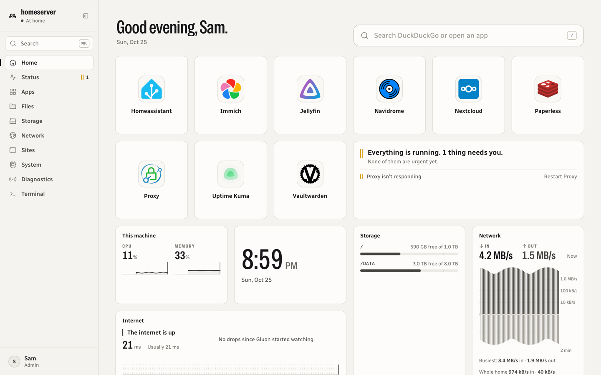
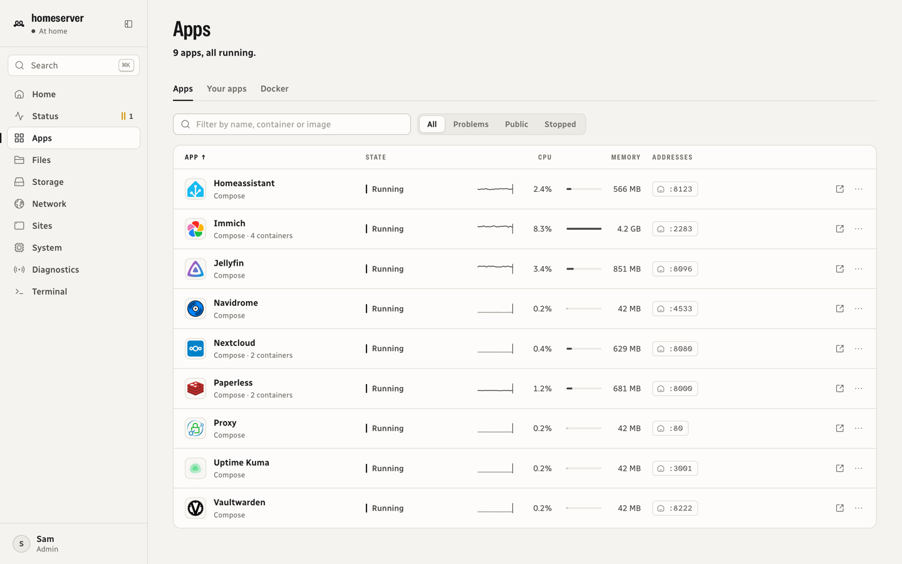
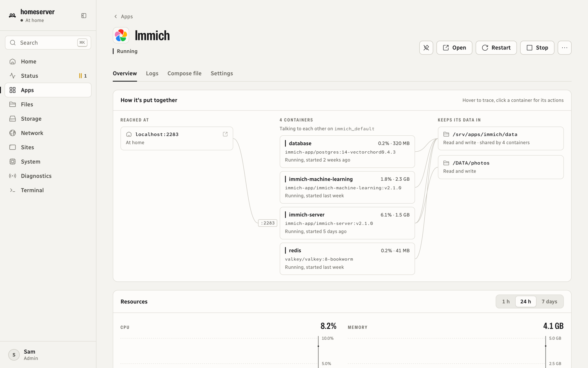
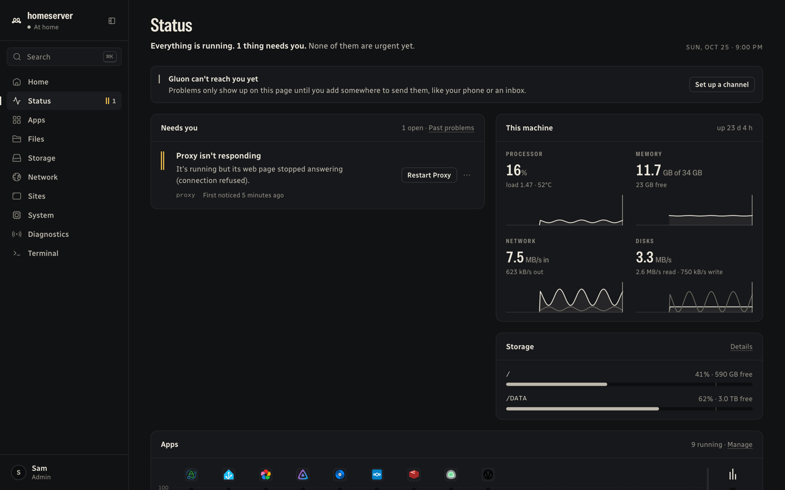
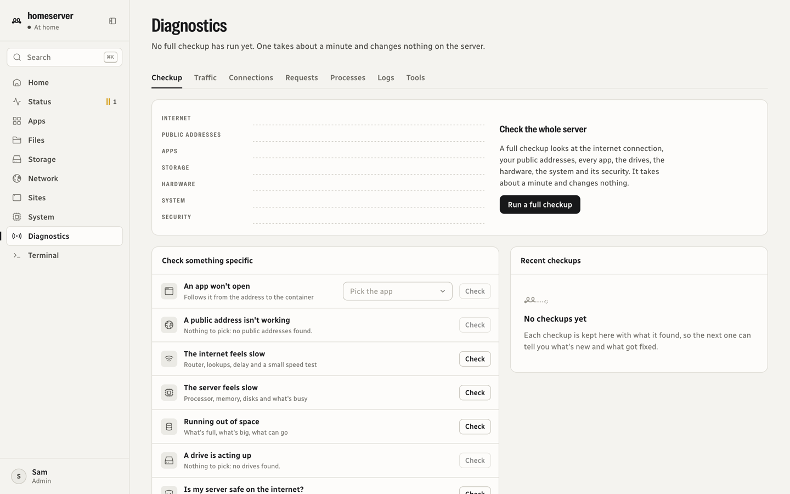
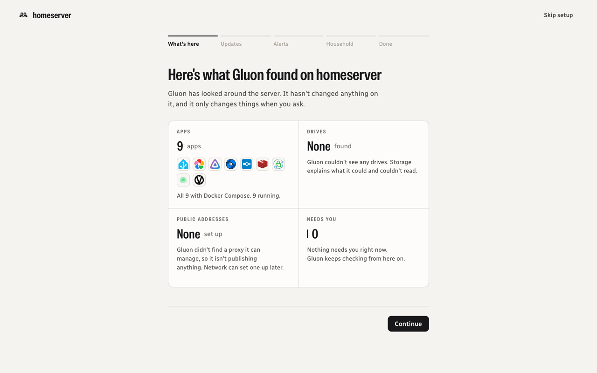
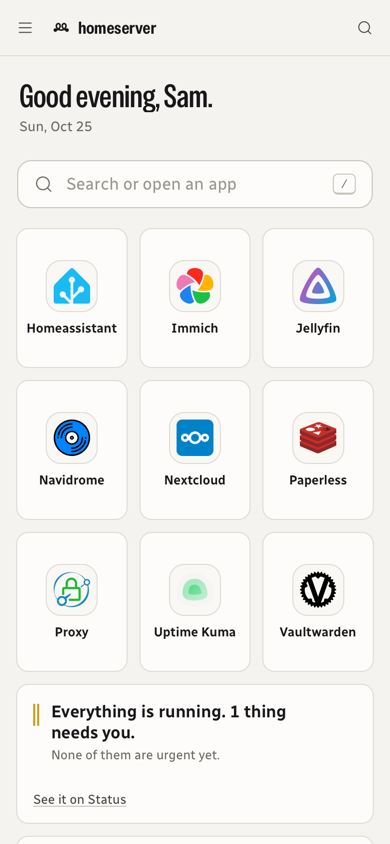

<p align="center">
  
</p>

<h1 align="center">Gluon</h1>

<p align="center">
  One calm web app for everything running on your home server, however it got there.
</p>

<p align="center">
  <a href="LICENSE"></a>
  
  
</p>



In physics, the gluon is the particle that holds everything together. This one holds a home server
together: health, apps, files, storage, network and diagnostics in one place, written in plain words.
When something's wrong, Gluon says what it is, why, and offers the fix.

> [!WARNING]
> Gluon is young and changes quickly. It runs privileged on the host with the Docker socket, so try
> it on a server you have backups of, and read [SECURITY.md](SECURITY.md) before putting it on the
> internet.

## What it does

- **Status and alerts.** One sentence says whether everything is fine; anything that needs you comes
  with its cause and a one-click fix. Uptime monitors, drive health, certificates, crash loops, and
  notifications through ntfy, Pushover, email or webhooks.
- **Apps.** Every Docker container and Compose stack, including ones Umbrel or CasaOS installed:
  live CPU and memory, logs, safe compose editing, and a diagram of how each app is put together.
  Umbrel's app store works from inside Gluon.
- **Files.** A file manager for the whole machine with pinned folders, previews, thumbnails, uploads
  and a trash. Household members only see the folders you share with them.
- **Storage.** Disks as the physical things they are, a map of what's using space, mounting drives
  and making mounts survive a restart, renaming mount points (with the apps that use them).
- **Network.** Which apps are on the internet, at what address, whether each one works and whether
  it asks for a login, drawn as a map from the visitor to the app. Manages
  [Caddy](https://caddyserver.com) routes and certificates.
- **Chat and voice.** Sets up and runs a Prosody (XMPP) chat server and a Mumble voice server, or
  takes over the ones you have: accounts, invite links, group chats, file sharing, phone
  notifications, and voice and video calls between homes through a coturn relay.
- **Router.** On AT&T BGW gateways (BGW320, BGW210), reads the router's own pages: the connection,
  fiber light level, live traffic, every device on the network, Wi-Fi and the firewall. With the
  router's access code it forwards the ports your apps need.
- **Game servers.** Minecraft Java addresses through mc-router (`survival.mc.example.com`, all on
  port 25565), each checked with a real server ping, and port forwards for other games.
- **Sites.** Plain web pages you make, upload or edit in the browser, published at an address of
  their own, with the last few versions kept for rolling back.
- **System.** OS updates, services, power, who's signed in over SSH, temperatures and memory by app.
- **Diagnostics.** A checkup that runs 60+ checks in seconds, targeted checks for "an app won't open"
  or "the internet is slow", and live traffic, connections, requests, processes and logs.
- **Home and household.** A start page for everyone in the house, with widgets for Jellyfin, Immich,
  Navidrome, Homebridge, Crafty Controller and more. Accounts with roles, invites with a QR code, a
  grid of who can open what, and an activity log of every change.

## Screenshots

| | |
| --- | --- |
|  |  |
| **Apps.** Every container and Compose stack, with live CPU and memory. | **How an app is put together**, from its address to its containers and data. |
|  |  |
| **Status**, in dark mode. Each problem comes with its fix. | **Diagnostics.** A full checkup, or a check for one specific problem. |
|  |  |
| **First run** shows what Gluon found before it changes anything. | **On a phone**, everything works the same. |

Light and dark follow your device. The screenshots come from a demo server with made-up data.

## Install

Gluon manages the host itself, so it runs as one privileged container on the host network, with the
Docker socket mounted. You'll need a Linux server with systemd, and Docker with the Compose plugin.

```sh
git clone https://github.com/reallukedev/gluon.git
cd gluon
docker compose -f docker/compose.yaml up -d --build
```

Open `http://<your server>:8130`. The first visit asks for a one-time setup code, printed in
`docker logs gluon`, and then for the first admin account.

### Public addresses (optional)

Network → Public addresses drives a [Caddy](https://caddyserver.com) container: Gluon writes
`routes.json` and a generated `Caddyfile` into Caddy's config folder and reloads Caddy through its
admin socket. Mount the config folder at `/proxy-caddy` and the admin socket's volume at `/run/caddy`
(see the comments in [`docker/compose.yaml`](docker/compose.yaml)).

### Reaching it from outside

Gluon is built to sit on the internet behind Caddy: passwords are hashed with argon2id, sign-ins are
throttled, admins need two-step sign-in when away from home, sessions are revocable, and every
change is recorded. Set up two-step sign-in from home before publishing it.

## Updates

Settings → Updates has two channels. **Stable** follows tagged releases. **Nightly** follows every
change pushed to `main`: Gluon checks every half hour and can install each nightly as it lands, or
once a day in an hour you pick. Updating downloads the new version, builds it on your server, swaps it
in, and puts the previous version back if the new one doesn't come up healthy. Switching from Nightly
back to Stable never downgrades on its own. Installs from Umbrel's app store can also update through
Umbrel.

## Development

You'll need Node 22 or newer.

```sh
npm install
npm run dev        # http://localhost:8130
npm test           # Vitest
npm run typecheck
npm run build
```

Most features expect a Linux host with Docker and reach the host through the privileged container
(`nsenter`), so a laptop only shows part of Gluon. `GLUON_ROUTER_GATEWAY` sets the router's address
when Gluon can't read it from the routing table (for example on a Mac). The scripts in `deploy/` ship
a checkout to your own server; copy `deploy/.env.example` to `deploy/.env` first.

Built with Next.js, React and Base UI. Design rules live in [DESIGN.md](DESIGN.md).

## Contributing

Bug reports, fixes and ideas are welcome. See [CONTRIBUTING.md](CONTRIBUTING.md), and report security
problems privately as described in [SECURITY.md](SECURITY.md).

## License

Gluon is free software under the [GNU General Public License v3.0 or later](LICENSE).
