<p align="center">
  
</p>

<h1 align="center">Gluon</h1>

<p align="center">
  One calm web app for everything running on your home server, however it got there.
</p>

<p align="center">
  <a href="https://github.com/slukedev/gluon/actions/workflows/ci.yml"></a>
  <a href="LICENSE"></a>
  
  
</p>

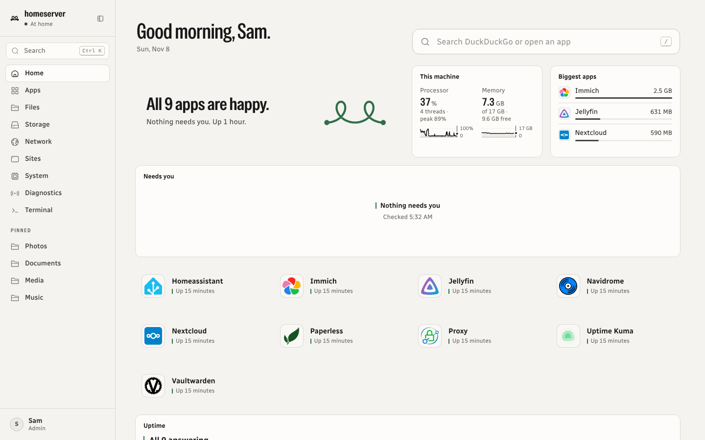

In physics, the gluon is the particle that holds everything together. This one holds a home server
together: health, apps, files, storage, network and diagnostics in one place, written in plain words.
When something's wrong, Gluon says what it is, why, and offers the fix.

> [!WARNING]
> Gluon is young and changes quickly. It runs privileged on the host with the Docker socket, so try
> it on a server you have backups of, and read [SECURITY.md](SECURITY.md) before putting it on the
> internet.

## Quick start

On a Linux server with Docker and the Compose plugin:

```sh
git clone https://github.com/slukedev/gluon.git
cd gluon
docker compose -f docker/compose.yaml up -d --build
```

The first build takes a few minutes. Then open `http://<your server>:8130` and enter the setup code,
which this prints:

```sh
docker exec gluon cat /data/setup-code
```

That's it. Gluon shows what it found on the server before it changes anything. More detail is under
[Install](#install).

## What it does

- **Health and alerts.** One sentence on Home says whether everything is fine; anything that needs
  you comes with its cause and a one-click fix. Uptime monitors, drive health, certificates, crash loops, and
  notifications through ntfy, Pushover, email or webhooks.
- **Apps.** Every Docker container and Compose stack, including ones Umbrel or CasaOS installed:
  live CPU and memory, logs, safe compose editing, and a diagram of how each app is put together.
  Umbrel's app store works from inside Gluon.
- **Files.** A file manager for the whole machine with pinned folders, previews, thumbnails, uploads
  and a trash. Household members only see the folders you share with them.
- **Storage.** Disks as the physical things they are, a map of what's using space, mounting drives
  and making mounts survive a restart, renaming mount points (with the apps that use them).
- **Network.** Which apps are on the internet, at what address, whether each one works and whether
  it asks for a login, drawn as a map from the visitor to the app. Manages
  [Caddy](https://caddyserver.com) routes and certificates.
- **Cloudflare.** With one API token, apps can have addresses in any of your domains
  (`media.example.com`, `example.net`), and Gluon writes their DNS records, keeps them pointed at your
  internet address and sends web traffic through Cloudflare's proxy. Each domain's DNS records can be
  added, edited and removed from the Network page.
- **Chat and voice.** Sets up and runs a Prosody (XMPP) chat server and a Mumble voice server, or
  takes over the ones you have: accounts, invite links, group chats, file sharing, phone
  notifications, and voice and video calls between homes through a coturn relay.
- **Router.** On AT&T BGW gateways (BGW320, BGW210), reads the router's own pages: the connection,
  fiber light level, live traffic, every device on the network, Wi-Fi and the firewall. With the
  router's access code it forwards the ports your apps need.
- **Game servers.** Minecraft Java addresses through mc-router (`survival.mc.example.com`, all on
  port 25565), each checked with a real server ping, and port forwards for other games. With
  Cloudflare connected, their DNS records are kept too.
- **Sites.** Plain web pages you make, upload or edit in the browser, published at an address of
  their own, with the last few versions kept for rolling back.
- **System.** OS updates, services, power, who's signed in over SSH, temperatures and memory by app.
- **Diagnostics.** A checkup that runs 60+ checks in seconds, targeted checks for "an app won't open"
  or "the internet is slow", and live use by app, traffic, connections, requests, processes and logs.
  A security checkup covers the firewall, IPv6, UPnP port openings on the router, SSH settings, keys
  and encryption, server accounts and sudo, file permissions, kernel protections, AppArmor or SELinux,
  automatic updates and OS support, container privileges and Gluon's own accounts.
- **Home and household.** A start page for everyone in the house, with widgets for Jellyfin, Immich,
  Navidrome, Homebridge, Crafty Controller and more. Accounts with roles, invites with a QR code, a
  grid of who can open what, and an activity log of every change.

## Screenshots

| | |
| --- | --- |
| 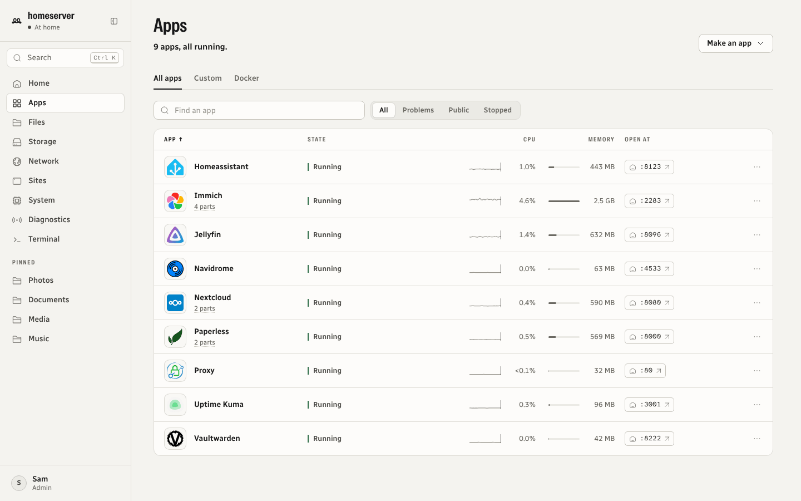 | 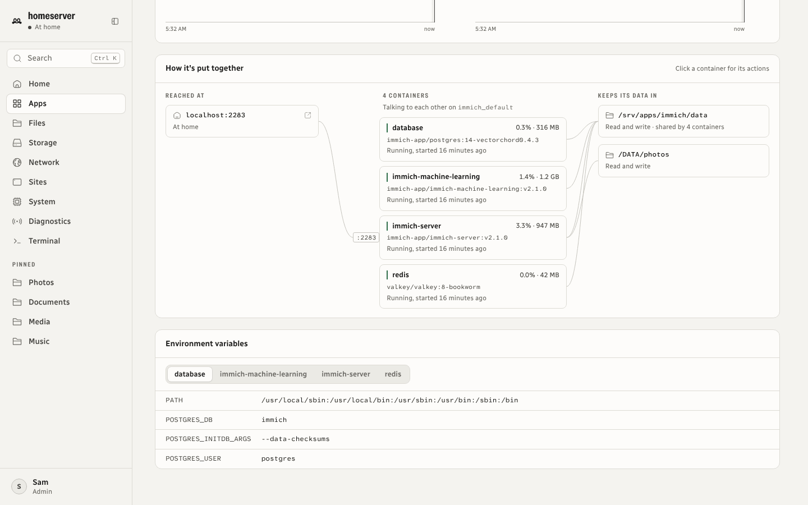 |
| **Apps.** Every container and Compose stack, with live CPU and memory. | **How an app is put together**, from its address to its containers and data. |
| 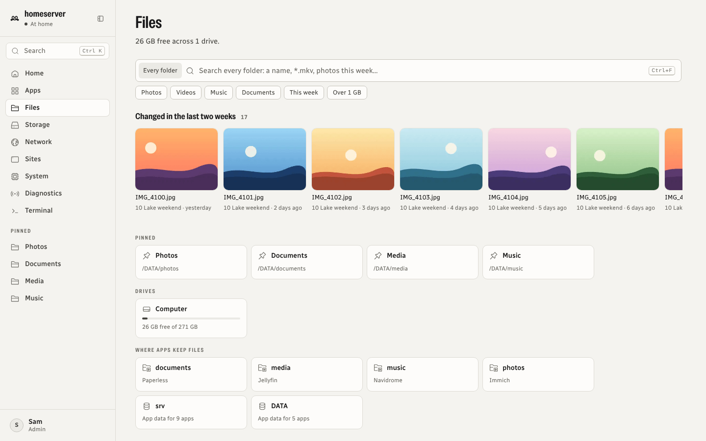 | 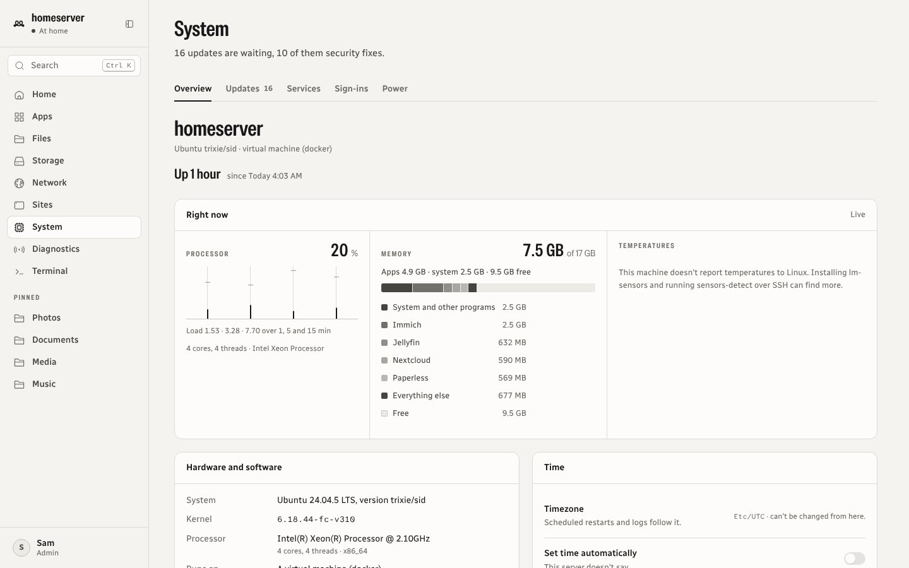 |
| **Files.** The whole machine, with pins, previews and the folders each app uses. | **System.** What the machine is doing, and which app is using the memory. |
| 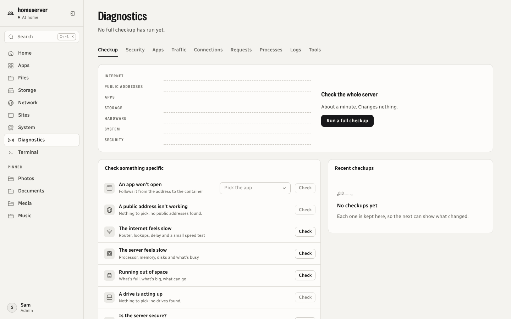 | 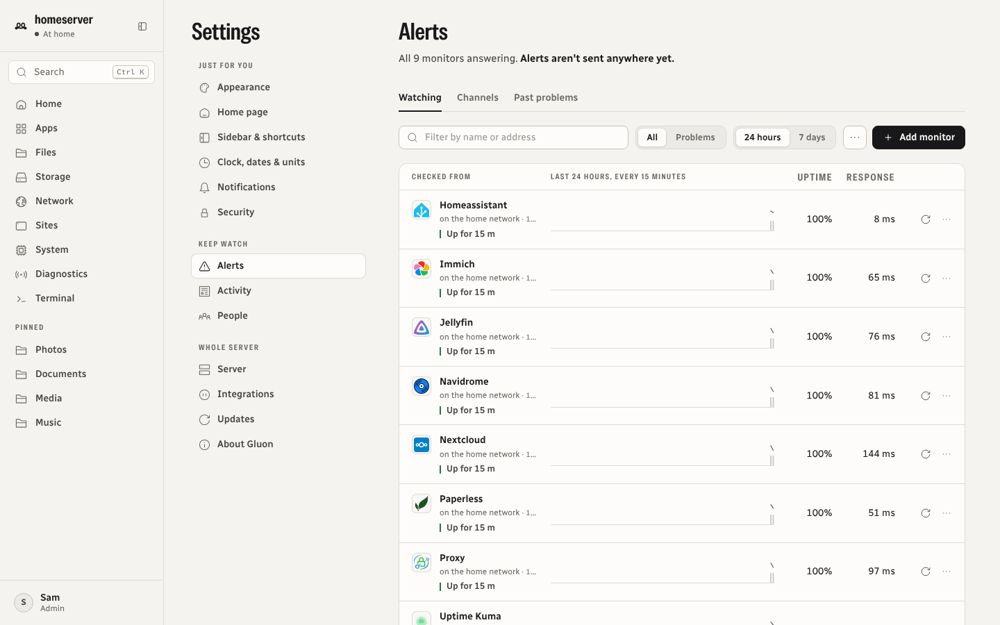 |
| **Diagnostics.** A full checkup, or a check for one specific problem. | **Alerts.** Uptime monitors and where notifications go. |
| 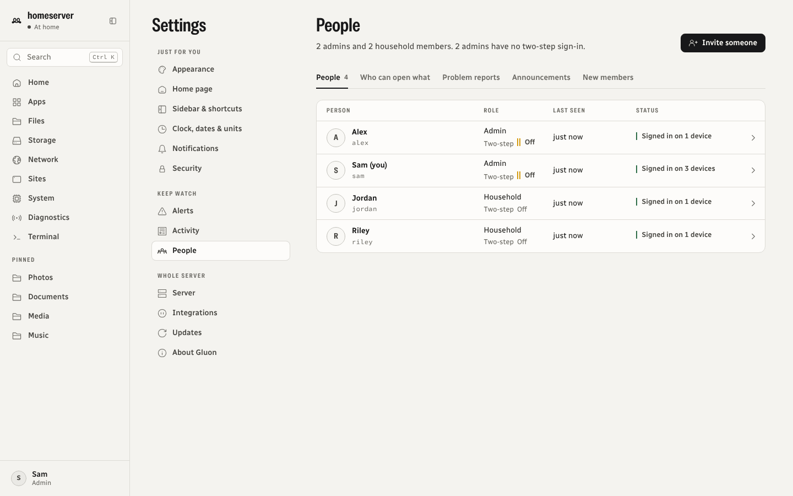 | 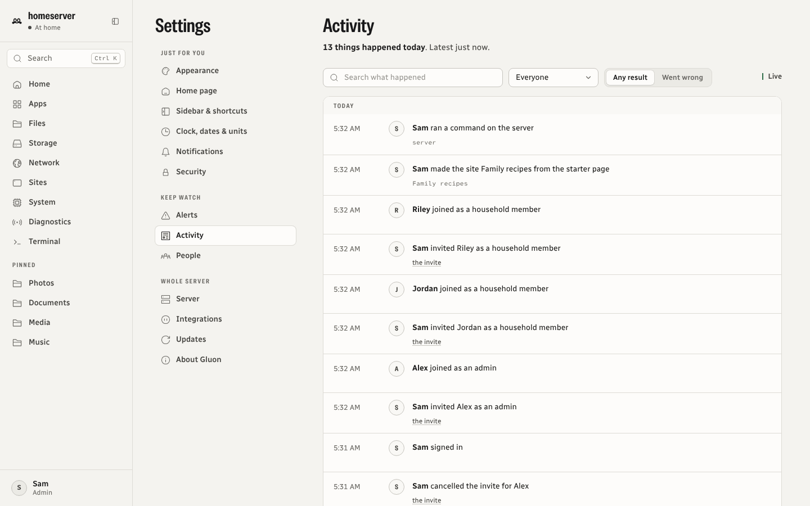 |
| **People.** Accounts for the household, each with only what you share. | **Activity.** Every change, who made it and when. |
| 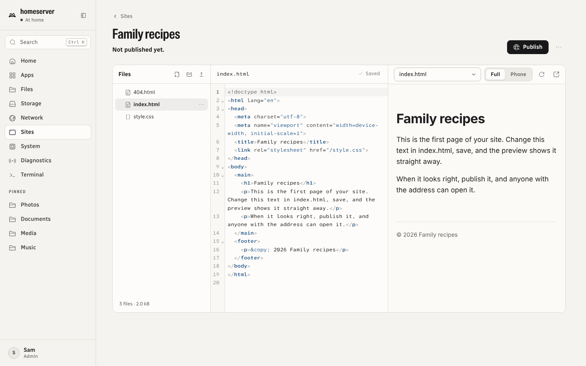 | 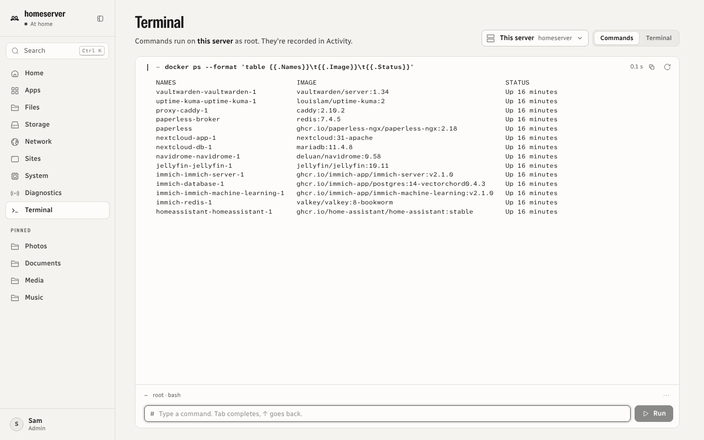 |
| **Sites.** Simple web pages, edited in the browser and published in a click. | **Terminal.** A shell on the server or in any container. |
| 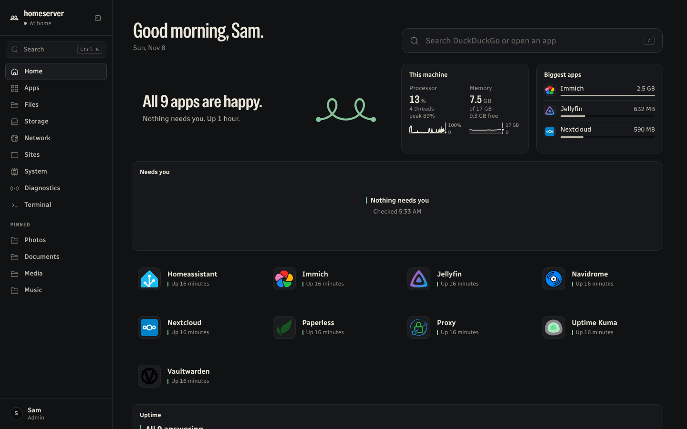 | 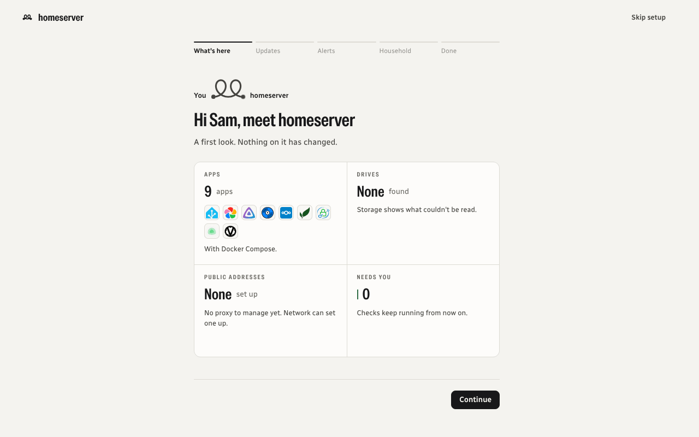 |
| **Dark mode** follows your device. | **First run** shows what Gluon found before it changes anything. |
| 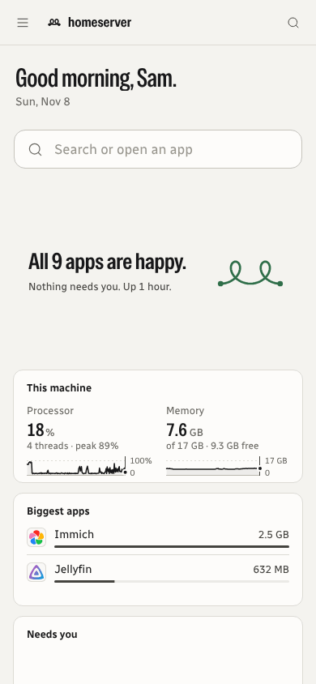 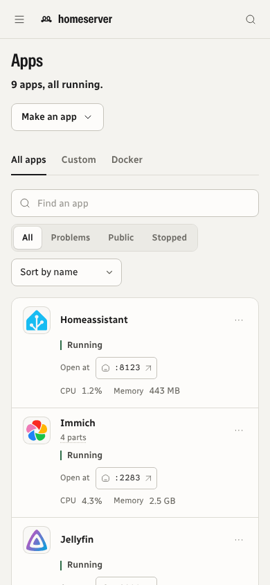 | |
| **On a phone**, everything works the same. | |

The screenshots come from a demo server with made-up data; [`scripts/screenshots`](scripts/screenshots) rebuilds it and takes them again.

## Install

### What you need

- A 64-bit Linux server with systemd (Debian, Ubuntu, Fedora, Raspberry Pi OS and the like).
- Docker with the Compose plugin. If `docker compose version` prints a version, you're set;
  otherwise follow [Docker's install guide](https://docs.docker.com/engine/install/).
- About 2 GB of free disk for the build. Gluon itself uses little memory once it's running.

Gluon manages the host itself (Docker, disks, mounts, systemd, the network), so it runs as one
privileged container on the host network with the Docker socket mounted. It can't be installed
without that access.

### Steps

1. Get the code and start it:

   ```sh
   git clone https://github.com/slukedev/gluon.git
   cd gluon
   docker compose -f docker/compose.yaml up -d --build
   ```

2. Open `http://<your server>:8130` in a browser. Use the server's address on your network, such as
   `http://192.168.1.10:8130`.
3. Enter the one-time setup code. It's printed when Gluon starts for the first time, and kept until
   the first account exists:

   ```sh
   docker exec gluon cat /data/setup-code
   ```

4. Create the first admin account, then follow the short first-run tour.

Umbrel and CasaOS installs can run Gluon the same way. Apps they installed show up in Gluon too.

### Configuration

Most settings live in the app. A few are environment variables in
[`docker/compose.yaml`](docker/compose.yaml):

| Variable | Default | What it does |
| --- | --- | --- |
| `PORT` | `8130` | The port Gluon listens on. |
| `TZ` | the container's | Time zone for schedules and times in logs, e.g. `Europe/London`. |
| `GLUON_DATA` | `/data` | Where Gluon keeps its database and settings (the `gluon-data` volume). |
| `GLUON_SECRET_KEY_FILE` | `$GLUON_DATA/secret.key` | The key that encrypts saved passwords and tokens. Put it on a separate volume or a Docker secret so a backup of the data volume can't be read on its own. An existing key moves there on the next start. Back it up separately: without it, saved credentials have to be entered again. |
| `GLUON_CADDY_DIR` | `/proxy-caddy` | Caddy's config folder, for public addresses. |
| `GLUON_CADDY_SOCKET` | `/run/caddy/admin.sock` | Caddy's admin socket. |
| `GLUON_CADDY_CONTAINER` | `caddy` | The name of the Caddy container. |
| `GLUON_APPS_DIR` | found on its own | Where your Compose apps live, if Gluon picks the wrong folder. |
| `GLUON_LAN_HOST` | found on its own | The address apps are linked at on your network. |
| `GLUON_ROUTER_GATEWAY` | from the routing table | The router's address, for the Router page. |
| `GLUON_GITHUB_TOKEN` | none | A GitHub token, only if update checks hit GitHub's rate limit. |

After changing one, run `docker compose -f docker/compose.yaml up -d` again.

### Public addresses (optional)

Network → Public addresses drives a [Caddy](https://caddyserver.com) container: Gluon writes
`routes.json` and a generated `Caddyfile` into Caddy's config folder and reloads Caddy through its
admin socket. Mount the config folder at `/proxy-caddy` and the admin socket's volume at `/run/caddy`
(see the comments in [`docker/compose.yaml`](docker/compose.yaml)).

### Cloudflare (optional)

Settings → Integrations → Cloudflare takes an API token with **Zone · DNS · Edit** and **Zone · Zone ·
Read** for your domains (add **Zone · Zone Settings · Read** and Gluon also warns when the SSL mode would
break proxied addresses). From then on:

- Publishing an app offers every domain the token can see, so an address can be `media.example.com`
  or another domain entirely, not only a name under the base domain.
- DNS records for public addresses are added, changed and removed as you publish apps. Gluon marks
  the records it makes ("Managed by Gluon") and leaves every other record alone unless you hand a
  name over with "Let Gluon manage".
- Those records follow your internet address (checked every 5 minutes), so a separate dynamic DNS
  container isn't needed. Game addresses get records too: every Minecraft address in mc-router and
  every game port with an address, always pointing straight here.
- Other names (a leftover like `play.example.com`, or a wildcard like `*.mc.example.com`) can be
  added under Other names and are kept pointed here the same way. Addresses under a wildcard Gluon
  keeps don't get records of their own.
- Coming from [cloudflare-ddns](https://github.com/favonia/cloudflare-ddns)? While it runs, Gluon
  leaves the names it updates alone, so the two never take turns rewriting a record. Take over adds
  its names to Gluon and hands their records over; Gluon only says it can be stopped once it keeps
  every one of them, and not while `DELETE_ON_STOP` would remove the records on the way out. Gluon
  takes over within a minute of it stopping.
- Web addresses go through Cloudflare's proxy, which hides your home's address. Uploads through it
  stop at 100 MB and video streaming isn't allowed, so any address can be marked Direct to keep a
  plain record pointing straight at your network. Chat and voice always go direct, and so do names
  more than one level under the domain, which Cloudflare's free certificate doesn't cover. Your
  router still forwards ports 80 and 443 to this server, and Cloudflare's SSL mode should be
  Full (strict).
- Network → Domains opens each domain's full DNS records: add, edit and remove A, AAAA, CNAME, TXT,
  MX and NS records and switch the proxy per record. Other types open in Cloudflare, and records Gluon
  keeps for public addresses are locked there.

### Reaching it from outside

Gluon is built to sit on the internet behind Caddy: passwords are hashed with argon2id, sign-ins are
throttled, admins need two-step sign-in when away from home, sessions are revocable, and every
change is recorded. Set up two-step sign-in from home before publishing it.

## Updates

Settings → Updates has two channels. **Stable** follows tagged releases. **Nightly** follows every
change pushed to `main`: Gluon checks every half hour and can install each nightly as it lands, or
once a day in an hour you pick. Updating downloads the new version, builds it on your server, swaps it
in, and puts the previous version back if the new one doesn't come up healthy. Switching from Nightly
back to Stable never downgrades on its own. Installs from Umbrel's app store can also update through
Umbrel.

To update by hand instead, from the `gluon` folder:

```sh
git pull
docker compose -f docker/compose.yaml up -d --build
```

## Backups

Everything Gluon knows (accounts, settings, history) is in the `gluon-data` volume. To save a copy
to the current folder:

```sh
docker run --rm -v gluon_gluon-data:/data -v "$PWD":/backup alpine tar czf /backup/gluon-data.tgz -C /data .
```

## Uninstall

From the `gluon` folder, stop and remove the container, keeping its data:

```sh
docker compose -f docker/compose.yaml down
```

Add `-v` to delete the data too. Gluon doesn't change your apps' containers or files when it's
removed; whatever you set up through it (mounts, Caddy routes, DNS records) stays as it is.

## Troubleshooting

- **The page doesn't open.** Check that the container is running with `docker ps`, read
  `docker logs gluon`, and make sure nothing else uses port 8130 (or change `PORT`).
- **It asks for a setup code you don't have.** Run `docker exec gluon cat /data/setup-code`.
- **Drives, services or the router are missing.** Gluon needs the privileged settings in
  `docker/compose.yaml` (`privileged`, `pid: host`, `network_mode: host`). Diagnostics → Checkup
  says what it couldn't read.

## Development

You'll need Node 22 or newer (the Docker image uses Node 24).

```sh
npm install
GLUON_DATA=./data GLUON_NO_NSENTER=1 npm run dev
```

Open http://localhost:8130. On first start the dev server prints a setup code, also saved in
`data/setup-code`. `GLUON_DATA` keeps development data in `./data` (ignored by git) instead of
`/data`, and `GLUON_NO_NSENTER=1` runs host commands directly on the machine you're on.

In production Gluon reaches the host through the privileged container (`nsenter`) and expects Linux
with Docker, so a laptop only shows part of Gluon. `GLUON_ROUTER_GATEWAY` sets the router's address when Gluon can't
read it from the routing table (for example on a Mac). For the full experience, run the dev image
(`docker/Dockerfile.dev`) on a Linux machine or VM. The scripts in `deploy/` ship a checkout to your
own server; copy `deploy/.env.example` to `deploy/.env` first.

### Checks

```sh
npm run typecheck
npm test             # unit tests (Vitest)
npm run test:e2e     # end-to-end tests (Playwright), see test/e2e/README.md
npm run build
```

Built with Next.js, React and Base UI. Design rules live in [DESIGN.md](DESIGN.md).

## Contributing

Bug reports, fixes and ideas are welcome. See [CONTRIBUTING.md](CONTRIBUTING.md) and the [code of conduct](CODE_OF_CONDUCT.md), and report security
problems privately as described in [SECURITY.md](SECURITY.md).

## License

Gluon is free software under the [GNU General Public License v3.0 or later](LICENSE).
